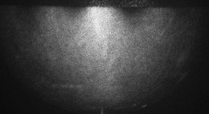

**Takahiro Hikida** | 指導教員: Dr. Kurt Hoffman 
Whitman College 物理学科 サマーリサーチ · 2025 年 6 月–8 月

::: {.callout-note}
本ページは要旨のみの日本語版です。実験方法・結果・考察を含むレポート全文は
[英語版](../../projects/espi-resonant-modes.qmd)をご覧ください。
:::

## 要旨

電子スペックルパターン干渉法（ESPI）を用いて、音響的に加振した物体の振動パターンを、
サイズと複雑さの順に可視化しました。対象は金属板（装置の特性評価）、金属半球、
ヴィオラの表板、スネアドラムのヘッド、そして予備実験としてピアノの響板です。
撮像の前に、レーザーのコヒーレンス長の下限を見積もり、参照ミラーのピエゾを較正し、
Moore と Skubal が導いた最適条件 $\gamma T = 2.32$ からピエゾの駆動条件を見積もりました。
半球では 64–1614 Hz に 9 つの共振が見られ、2 通りの設置で共通して観測された 6 つのうち 5 つは
3 Hz 以内で一致しました。有限要素（COMSOL）モデルと対応づけられた共振のうち、高次の 4 つは
10% 以内で一致した一方、最低次のシェルモードは 78% ずれていました。
ヴィオラでは約 200–1000 Hz のすべての周波数でパターンが見え、特に 9 つの周波数付近で強く応答しました。
駒の張力を変えても、再現性のある周波数シフトは見られませんでした。
ドラムヘッドは 0.1 V 前後の弱い駆動が必要で、非対称なモードを示しました。これはヘッドの張力が不均一であることと整合します。

{width=60%}
